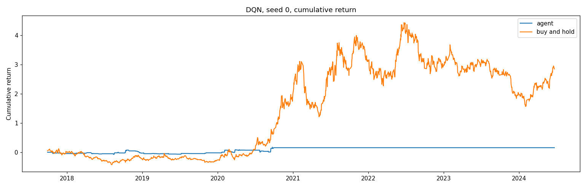
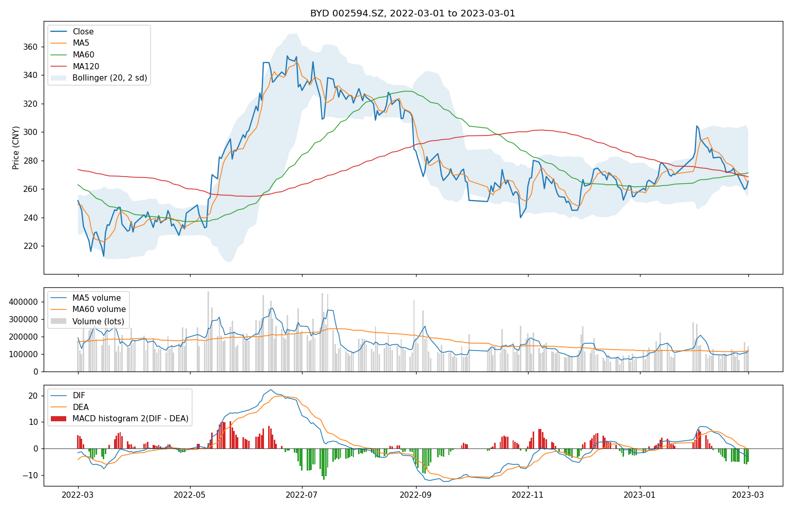

# Deep Q-Learning Trading on BYD (002594.SZ)

A research-assistant project from summer 2024 (University of Nottingham Ningbo China): technical-indicator features and a deep Q-network (DQN) that trades a single A-share stock, BYD. In 2026 I reviewed the original code, fixed the bugs listed below and re-ran the backtest over 10 random seeds instead of one.

**Result in one line:** across 10 seeds the agent never beat buy and hold over the 2017-2024 test period. Outcomes ranged from -14% to +186% depending only on the random seed. A single lucky run would have looked like a working strategy.

## Pipeline

| Step | File | What it does |
|---|---|---|
| Data | `src/data.py` | Unadjusted daily bars from BaoStock (free, no token), 2011-06-30 to 2024-06-25 |
| Features | `src/indicators.py`, `src/build_features.py` | Moving averages, MACD, RSI, KDJ, Bollinger bands, volume averages; price / volume / MACD chart |
| Environment | `src/stock_env.py` | State = last 6 daily returns; actions = hold, buy with all cash (100-share lots), sell all; commission 0.03% (5 CNY minimum) and 0.1% stamp duty |
| Agent | `src/dqn_agent.py` | DQN in PyTorch: one hidden layer, experience replay, target network |
| Experiment | `src/train_dqn.py` | Train on the first 1500 trading days, backtest greedily on the rest, repeat for each seed, with and without an MA21 trend filter |

```bash
pip install -r requirements.txt
python src/build_features.py       # downloads data on first run
python src/train_dqn.py --seeds 10
```

## Results (historical backtest)

Train 2011-07-28 to 2017-09-25, test 2017-09-26 to 2024-06-25 (1635 trading days), net of costs.

| Strategy | Median total return | Worst seed | Best seed | Seeds beating buy and hold | Median Sharpe | Median max drawdown |
|---|---|---|---|---|---|---|
| DQN | 29.6% | -14.0% | 185.5% | 0 / 10 | 0.39 | -28.9% |
| DQN + MA21 trend filter | 5.3% | -16.6% | 55.2% | 0 / 10 | 0.12 | -21.5% |
| Buy and hold | 285.6% | | | | 0.68 | -52.8% |

Per-seed numbers are in `results/seeds.csv`.



What the numbers say:

- **Seed variance dominates.** The same code and data gave anything from a loss to +186%. Reporting one run, as the 2024 version did, says almost nothing about the method.
- **The agent learns to sit in cash.** With a state of only six past returns and a reward that penalizes being flat by just 10% of the missed move, several seeds stop trading early (seed 0 above holds cash from late 2020) and miss BYD's 2020-2022 rally.
- **Lower drawdowns are not alpha.** The agent's drawdowns are smaller than buy and hold's -52.8%, but only because it is mostly out of the market; its median Sharpe is still lower.
- **The MA21 filter hurts here.** It cuts drawdowns further but exits too often in a trending stock.

Prices are unadjusted, so dividends are ignored for both the agent and buy and hold.



## Bugs fixed in the 2026 review

| Problem in the 2024 version | Effect | Fix |
|---|---|---|
| Indicators computed before sorting by date (the API returned rows out of order) | MA5 off by 22 CNY on average in the DQN's training data | Sort first; `add_indicators` rejects unsorted data |
| Download wrote the API's error message (JSON) into the data file | Two CSV files contained only an error message | Check the HTTP status and content before saving; BaoStock replaces the paid API |
| Warm-up values filled with 0 | RSI = 0 read as "extremely oversold" | Keep NaN |
| MACD histogram written as `2*dif - dea` | Wrong histogram | `2 * (dif - dea)` |
| Reward shaping skipped 0.03 < \|r\| < 0.05 | Previous step's reward leaked into the next | Complete piecewise function, used in every state |
| Buy with too little cash for the commission | Bought 0 shares and paid a 5 CNY fee | Skip the trade |
| Target-network output not detached; greedy action returned as a tensor | Gradient leak, slow action selection | `torch.no_grad()`, `.item()` |
| API token hard-coded in 10 files | Secret in source | Removed; no token needed now |
| One training run | Results not reproducible or comparable | Seeded runs, 10 seeds reported |

## Credits

The environment and agent started from an open-source DQN stock-trading example by "hcb" (2020); feature engineering, the BYD data pipeline, the fixes above and the multi-seed experiment are my own.
